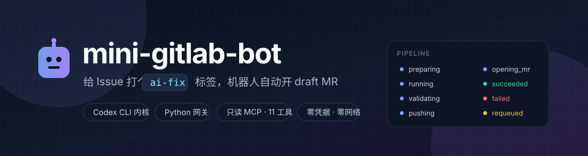
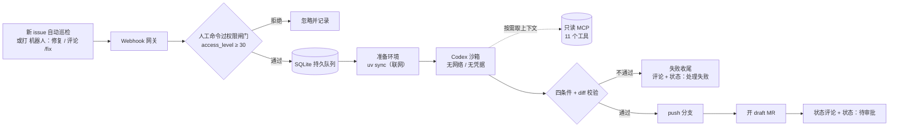

<div align="center">
  
</div>

<h1 align="center">mini-gitlab-bot</h1>

<p align="center">
  新 issue 自动巡检、打中文标签；打上 <code>机器人：修复</code> 后自动修复并开 <b>draft MR</b>。<br>
  周期扫描漏掉的 issue、用 commit 引用自动回帖关闭；在 main 打 tag 后自动补 <b>Release</b> 文案。<br>
  Codex CLI 做 AI 内核，Python 网关做触发器 / 上下文准备 / 收尾编排。
</p>

<p align="center">
  <a href="https://github.com/FlyingHeNanman/mini-gitlab-bot/actions/workflows/ci.yml">
    
  </a>
  <a href="https://github.com/FlyingHeNanman/mini-gitlab-bot/releases">
    
  </a>
  <a href="LICENSE">
    
  </a>
  
  <a href="https://github.com/FlyingHeNanman/mini-gitlab-bot/pkgs/container/mini-gitlab-bot">
    
  </a>
</p>

---

## 它解决什么问题

内网 GitLab 上，一个 issue 从"有人报"到"有人改"经常要排很久。这个机器人把中间那段自动化：

> **新 issue 自动巡检 → 打类型/严重度/组件标签 → 人工打 `机器人：修复` → 拉代码 → 装依赖 → AI 改代码 → 跑测试 → 推分支 → 开 draft MR → 回帖告诉你结果**

合并永远由人决定。机器人的产出是 issue 上的**巡检结论 + 状态评论**，以及（人工确认后）一个 **draft MR**；
  另有两条兜底链路：**周期扫描**补做漏投的巡检、识别 `Closes/Fixes/Resolves #N` 自动回帖（open 时关闭；GitLab 已 autoclose 则补标记），**Tag Push** 后按提交分类补 GitLab Release 说明；以及一个只读 **Dashboard** 看队列、失败与项目状态。

## 一次完整的闭环

真实跑出来的结果（GitLab CE 19.5 + 真 codex，41 秒）：

```text
issue #8  「parse_labels 在空标签时返回 None」
  └─ alice 新开 issue（自动巡检，无需打标签）
       ├─ 只读 clone → 真跑 pytest 复现 → 定位 app.py
       ├─ 打上 类型：缺陷 / 严重度：一般 / 组件：其他 / 状态：待人工处理
       └─ 回帖：结论 + 复现证据 + 定位文件
  └─ alice 再打上 `机器人：修复` 标签（人工确认）
       ├─ 权限闸门：alice 是 Developer(30) ✓
       ├─ 准备环境：uv sync（网关侧联网）→ 离线自检 ✓
       ├─ Codex 沙箱：无网络、无凭据，读 context.md → 改 app.py
       │    `return None` → `return []`，自己跑 pytest：2 passed
       ├─ 四条件 + diff 校验 ✓ → push 分支 ai-fix/8-…
       ├─ 开 draft MR：「Draft: fix(issue-8): parse_labels 在空标签时返回 None」
       │    描述里有 Closes #8、agent 的 report.json 摘要、验证命令与结果
       └─ issue 上贴状态评论，标签流转 状态：自动修复中 → 状态：待审批
```

失败也会说话：`状态：处理失败` + 一条带**失败阶段、原因、日志尾部**的评论，而不是静默消失。

## 周期扫描与自动 Release

两条链路都复用同一个持久队列与状态机，不额外起服务：

- **补偿巡检**（`SWEEP_TRIAGE_ENABLED`）：每 `SWEEP_INTERVAL_SEC` 扫白名单项目里「open 且没有 `状态：` 标签」的 issue，按每项目每小时配额补建 triage，专治 webhook 漏投。
- **commit 引用回收**（`SWEEP_RESOLVE_ENABLED`）：扫默认分支最近 `SWEEP_COMMIT_LOOKBACK_DAYS` 天提交，遇到 `Closes #12` / `Fixes #12, #13` / `Resolves #12` 时，对仍 open 的 #12 回帖「已由提交修复」、打 `状态：已解决` 并关闭。评论带 marker，重跑只更新同一条。
- **自动 Release**（`RELEASE_ENABLED`）：Tag Push Hook 产生**新建 tag**时（忽略分支 push、删 tag、移动/重推 tag），找上一个 tag → compare 提交 → 按 Conventional Commits 分组生成中文 release notes → 创建 GitLab Release。已有 Release 不覆盖。

## 工作流



## 为什么不是"把 issue 直接丢给 AI"

| 问题 | 这里的做法 |
| --- | --- |
| AI 可能拿到凭据并外泄 | **agent 零凭据**：GitLab token 只存在于网关进程；git 凭据只经 `GIT_ASKPASS` 进，绝不进 argv |
| AI 可能联网乱跑 | **agent 零网络**：`--sandbox workspace-write` + 显式关闭 network；装依赖在网关的联网阶段做完 |
| AI 可能改 CI 配置 / 密钥 | **diff 校验**：禁改路径 + 文件数/行数上限，命中就在 push 之前拦下 |
| AI 可能"假装完成" | **四条件判定**：`exit 0` 且出现 `turn.completed` 且 `-o` 文件本次新写入 且 diff 非空 |
| AI 可能直接合代码 | **永远只开 draft MR**，合并必须人工审批 |
| 出问题查不到 | 每个任务都有状态机流水、失败阶段/原因、codex 原始 JSONL 日志（14 天） |

## 快速开始

### 1. 起服务

```bash
git clone https://github.com/FlyingHeNanman/mini-gitlab-bot.git
cd mini-gitlab-bot

docker pull ghcr.io/flyinghenanman/mini-gitlab-bot:0.2.0   # 或本地 docker compose build

cp .env.example .env
# 至少填：WEBHOOK_SECRET / GITLAB_TOKEN / GITLAB_READONLY_TOKEN / REPO_WHITELIST / MODEL_BASE_URL
docker compose up -d
```

`docker compose` 会挂两个卷：`/data`（SQLite + 日志）、`/work`（job 目录 + uv 缓存）。

> **给容器 `seccomp=unconfined`**（compose 里已配好）：Codex 的 Linux 沙箱用 bubblewrap 创建
> 非特权 user namespace，Docker 默认 seccomp 会拒绝，表现为 agent 一条命令都执行不了。

### 2. GitLab 侧准备

| 步骤 | 说明 |
| --- | --- |
| 机器人账号 | 建一个专用账号（如 `gitlab-bot`），角色 **Developer**，不要给 Maintainer/Owner |
| 两个 Token | 主 token：`api`；只读 token：`read_api`（给 MCP 用，物理上不能写） |
| 标签 | 不需要手工建：机器人第一次干活时自动创建 32 个中文标签（类型/严重度/组件/状态/证据/风险/命令），其中 `状态：已解决` 用于 commit 引用自动关闭 |
| Webhook | Settings → Webhooks → `http://<bot 容器>:8080/webhook/gitlab`，Secret 与 `WEBHOOK_SECRET` 一致，勾 **Issues events**、**Comments**、**Merge request events**、**Tag push events** |

### 3. 触发

- **自动巡检**：新开 / 重开 issue 即触发（`TRIAGE_ENABLED=true`，默认开）；
- **修复**：在 issue 上打 `机器人：修复` 标签，或评论 `/fix`；
- **重跑巡检**：打 `机器人：巡检` 标签，或评论 `/triage`（人工命令需 Developer=30）；
- **跳过**：打 `机器人：跳过` 标签，机器人不再自动巡检该 issue；
- **自动 Release**：在仓库里新建 tag（通常打在默认分支）即触发，机器人补 Release 说明；
- **周期扫描**：`SWEEP_ENABLED=true` 时默认每 30 分钟跑一轮，无需手工触发。

旧标签（`ai-fix*`）已硬切；从旧版本升级时跑一次：

```bash
export GITLAB_URL=https://gitlab.example.com GITLAB_TOKEN=glpat-xxx
python scripts/migrate_labels.py --project group/project-a            # 预演
python scripts/migrate_labels.py --project group/project-a --apply    # 执行
```

之后去 issue 看巡检/状态评论，或去看 draft MR。

## 可观测性

| 端点 | 用途 |
| --- | --- |
| `GET /healthz` | 存活探针（不含任何任务信息） |
| `GET /readyz` | 就绪：数据库可读 / worker 在跑 / 没有卡死任务 |
| `GET /metrics` | Prometheus 文本：`tasks_total{state}`、`task_duration_seconds`、`queue_depth`、`worker_inflight`、`sweep_*`、`release_*`… |
| `GET /tasks` | **只读任务页**（token 保护）：状态、失败阶段、原因、耗时、MR 链接，点进去看日志尾部 |
| `GET /tasks.json` | 同上，给脚本用 |
| `GET /dashboard` | **只读观测台**（HTTP Basic）：健康、队列、24h 统计、失败中心、项目、最近任务 |

`/tasks` 默认开启但**必须带 token**：没配 `ADMIN_TOKEN` 时首次启动自动生成，持久化到
`<DB_PATH 同目录>/admin_token`（0600），`cat /data/admin_token` 取即可。

`/dashboard` 默认关闭（fail closed）：设置 `DASHBOARD_PASSWORD` 后才启用，用
`DASHBOARD_USERNAME`（默认 `admin`）+ 该密码走浏览器 HTTP Basic 登录。只读，手动刷新；
当前实例只看自己的 SQLite。设计见 [docs/design/dashboard.md](docs/design/dashboard.md)。
日志是结构化 JSON，每行自带 `task_id`；保留策略：日志 14 天、终态任务 90 天。

## 安全模型

```
┌───────────────────────── 网关进程（有网、有凭据）─────────────────────────┐
│  Webhook → 权限闸门 → 队列 → clone/commit/push → 开 MR → 评论/标签          │
│                                     │                                      │
│                          ┌──────────▼──────────┐                           │
│                          │  Codex 沙箱（子进程）│  无网络 · 无 GitLab 凭据   │
│                          │  只能写 job 目录     │  读 context.md / 改代码    │
│                          └──────────┬──────────┘                           │
│                                     │ 只读 MCP（read_api token，项目绑定）  │
└─────────────────────────────────────┼──────────────────────────────────────┘
                                      ▼
                             GitLab API（只读 11 个工具）
```

- 安全关键配置全部用 `-c` 下发（优先级高于仓库自带配置），启动前删除 workdir 里的 `.codex/`
- 只读 MCP **工具 schema 里没有 `project` 参数**，项目由网关经环境变量绑定 —— agent 物理上换不了项目
- 每个 job 独立 `TMPDIR`；任务本地产物（`.mini-gitlab-bot/`、`.venv/`…）绝不进提交

## 配置

<details>
<summary><b>常用环境变量（完整列表见 <code>.env.example</code>）</b></summary>

| 变量 | 说明 | 默认 |
| --- | --- | --- |
| `WEBHOOK_SECRET` | Webhook secret；未配置则一律 401 | — |
| `REPO_WHITELIST` | 允许处理的项目，逗号分隔；空 = 全部拒绝 | 空 |
| `GITLAB_URL` / `GITLAB_TOKEN` | 实例地址 / 主 token（`api`） | — |
| `GITLAB_READONLY_TOKEN` | 只读 token（`read_api`），给 MCP | — |
| `BOT_USERNAME` | 机器人账号，用于忽略自己产生的事件 | — |
| `MIN_ACCESS_LEVEL` | 触发者角色下限（Developer = 30） | `30` |
| `TRIAGE_ENABLED` | 新 issue 自动巡检（排查/打中文标签/回帖） | `true` |
| `SWEEP_ENABLED` / `SWEEP_INTERVAL_SEC` | 周期扫描总开关 / 间隔秒数 | `true` / `1800` |
| `SWEEP_RESOLVE_ENABLED` | 用 commit 引用自动回帖；open issue 同时关闭，已 closed 则补标签/评论 | `true` |
| `RELEASE_ENABLED` | Tag Push 自动补 GitLab Release | `true` |
| `RELEASE_LOOKBACK_DAYS` | 首个 tag 回退多少天提交来生成说明 | `365` |
| `ALLOWED_TRIGGER_USERS` | 可选额外白名单（与角色下限是 AND） | 空 |
| `MODEL_BASE_URL` / `MODEL_NAME` | 内网模型端点（需支持 Responses API）/ 模型名 | — |
| `LLM_API_KEY` | 模型 key（只进 agent 子进程环境） | — |
| `CODEX_BIN` / `CODEX_EXPECTED_VERSION` | codex 路径 / 期望版本 | `codex` / 空 |
| `AGENT_TIMEOUT_SEC` | 单次 codex 会话超时 | `1800` |
| `AGENT_CONCURRENCY` | 并发任务数 | `2` |
| `DIFF_MAX_FILES` / `DIFF_MAX_LINES` | 改动规模上限 | `50` / `2000` |
| `FORBIDDEN_PATHS` | 禁改路径 | CI 配置、密钥… |
| `LOG_DIR` / `LOG_RETENTION_DAYS` | 日志目录 / 保留天数 | `/data/logs` / `14` |
| `ADMIN_TOKEN` | `/tasks` 的 token；空 = 自动生成 | 空 |
| `DASHBOARD_ENABLED` | Dashboard 总开关 | `true` |
| `DASHBOARD_USERNAME` / `DASHBOARD_PASSWORD` | Dashboard 的 HTTP Basic 凭据；密码空 = 关闭 | `admin` / 空 |

</details>

## 开发

协作约束见 [AGENTS.md](AGENTS.md)；**任何 UI 设计与实现先读 [DESIGN.md](DESIGN.md)**，以其中的 token 和版面规范为准。

```bash
export UV_CACHE_DIR=$PWD/.uv-cache     # 沙箱里必须可写
uv sync
uv run ruff check . && uv run ruff format --check .
uv run pytest                          # 655 项，无需 GitLab / 无需 LLM
```

预览 Dashboard（临时 SQLite + 样例任务，不接真 GitLab）：

```bash
uv run python scripts/preview_dashboard.py
# http://127.0.0.1:8099/dashboard；Basic Auth: admin / preview2026
```

测试分层：

- **单元**：状态机、策略、渲染、配置、脱敏、MCP 协议
- **集成（假件）**：假 SCM/VCS/agent 把整条流水线（含失败、恢复、崩溃重启）跑穿
- **集成（真件）**：真 git 仓库、真 `uv sync`、真 HTTP 打桩 GitLab、**真子进程**的 codex / MCP

想在**真 GitLab** 上跑完整闭环（含越权用例）：

```bash
./scripts/e2e/run.sh --reuse --keep          # 桩 agent
# 或接真 codex：
E2E_STUB_AGENT=0 MODEL_BASE_URL=… MODEL_NAME=… LLM_API_KEY=… ./scripts/e2e/run.sh --reuse
```

## 项目结构

<details>
<summary><b>端口 / 适配器分层</b></summary>

```
core/      状态机 · 领域模型 · diff 策略 · context.md 渲染 · 编排器 · worker
           · 周期扫描（sweep）· Release 说明/编排 · MCP 工具契约 · 日志
           · 指标 · 任务页渲染                              ← 纯逻辑，零 IO
ports/     store · scm · vcs · agent · workspace · env · notifier · janitor
adapters/  sqlite_store · gitlab_client · git_cli · codex_cli · uv_env
           · local_workspace · janitor · proc（子进程+脱敏）· fakes · unavailable
gateway/   app(HTTP) · config · webhook · permissions · runtime(装配) · mcp_readonly
tests/     unit / integration / stub_gitlab（可编程的 GitLab API 桩）
scripts/   e2e（真 GitLab 端到端）
docs/      PLAN 事实核查 · 文案模板 · 发版流程
```

依赖方向单向：`gateway → adapters → ports → core`，`core` 不 import 任何 IO。

</details>

## 已验证 / 未验证

| 项 | 状态 |
| --- | --- |
| 单元 + 集成测试 | ✅ 655 项全绿（CI 每次 push/PR 都跑） |
| 自动巡检（真件） | ✅ GitLab CE 19.5.3 + 真 codex 0.166 + Ark：新 issue → 只读检出 → 复现 → 中文标签/评论，重开幂等 |
| 自动修（真件） | ✅ 巡检判定 eligible → 内部派生 fix → 真 codex 修复 → draft MR（父任务链、draft、Closes 均验证） |
| 重复/指派 | ✅ 高置信重复关联并关闭；CODEOWNERS 命中即指派；GitLab assign/link/close API 已真机验证 |
| 合并解释（真件） | ✅ 真 GitLab MR merge → 不 clone、只看 diff → 真 codex 解释评论 + 状态：已合并 |
| 周期扫描 / 自动关闭 | ✅ 真 GitLab CE 19.5.3：open issue → 回帖/`状态：已解决`/关闭；GitLab autoclose 先关闭时，近期 closed issue 也会补回帖/标签，marker 幂等 |
| 自动 Release | ✅ 真 GitLab CE 19.5.3：Tag Push → Release、previous tag compare、修复/新功能分组；已有 Release 跳过由假件覆盖 |
| Dashboard | ✅ 只读观测台：HTTP Basic、总览/失败中心/项目聚合/最近任务/任务详情，655 项测试覆盖；当前仅单实例 SQLite |
| 真 GitLab 闭环 | ✅ GitLab CE 19.5：打标签 → draft MR → 单条评论 → 标签流转，15/15 断言 |
| 真 codex 修复 | ✅ codex 0.157.1 + 内网模型端点：自主改代码、跑 pytest、写报告，41 秒 |
| 只读 MCP | ✅ 11 个工具在真实 GitLab 数据上逐个验证（含真实 CI 日志） |
| 镜像 | ✅ 多阶段构建（1.2 GB），容器内非 root 跑通完整闭环 |
| 非 Python 项目 | ❌ 未支持（首期只做 uv 管理的 Python 项目） |
| 非 GitLab 平台 | ❌ 未支持（GitHub/Gitea 只是端口层面的可能性） |
| 其他 GitLab 版本 | ⚠️ 只验证过 19.5；16/17/18 未逐一测试 |
| GitLab 默认自动关闭 | ✅ 已兼容：`autoclose_referenced_issues=true` 时 GitLab 先关闭，sweep 扫近期 closed issue 补回帖/标签，不重复处理 |

## 文档

- [PLAN.md](PLAN.md) —— 架构定案、关键决策、已验证的技术事实、每个里程碑的落地记录
- [docs/design/auto-triage.md](docs/design/auto-triage.md) —— 触发/巡检/标签/周期扫描与自动 Release 的设计
- [CHANGELOG.md](CHANGELOG.md) —— 版本变更
- [docs/RELEASING.md](docs/RELEASING.md) —— 分支模型与发版流程
- [docs/verification/v0.2-real-gitlab.md](docs/verification/v0.2-real-gitlab.md) —— v0.2 周期扫描与自动 Release 的真 GitLab 验证记录
- [docs/templates.md](docs/templates.md) —— MR 描述 / 状态评论 / report.json 的模板
- [docs/research/](docs/research/README.md) —— 事实核查依据（Codex、GitLab、MCP 的行为）

## 许可

[Apache License 2.0](LICENSE)
