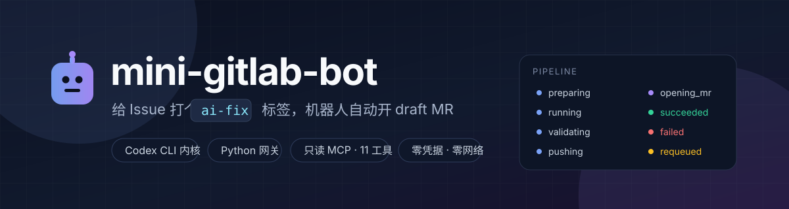
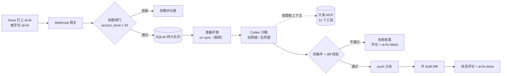

<div align="center">
  
</div>

<h1 align="center">mini-gitlab-bot</h1>

<p align="center">
  给 GitLab Issue 打上 <code>ai-fix</code> 标签，机器人自动修复并开一个 <b>draft MR</b>。<br>
  Codex CLI 做 AI 内核，Python 网关做触发器 / 上下文准备 / 收尾编排。
</p>

<p align="center">
  <a href="https://github.com/FlyingHeNanman/mini-gitlab-bot/actions/workflows/ci.yml">
    
  </a>
  <a href="https://github.com/FlyingHeNanman/mini-gitlab-bot/releases">
    
  </a>
  <a href="LICENSE">
    
  </a>
  
  <a href="https://github.com/FlyingHeNanman/mini-gitlab-bot/pkgs/container/mini-gitlab-bot">
    
  </a>
</p>

---

## 它解决什么问题

内网 GitLab 上，一个 issue 从"有人报"到"有人改"经常要排很久。这个机器人把中间那段自动化：

> **打标签 → 拉代码 → 装依赖 → AI 改代码 → 跑测试 → 推分支 → 开 draft MR → 回帖告诉你结果**

合并永远由人决定。机器人的产出只有两样：一个 **draft MR**，和 issue 上一条**持续更新**的状态评论。

## 一次完整的闭环

真实跑出来的结果（GitLab CE 19.5 + 真 codex，41 秒）：

```text
issue #8  「parse_labels 在空标签时返回 None」
  └─ alice 打上 ai-fix 标签
       ├─ 权限闸门：alice 是 Developer(30) ✓
       ├─ 准备环境：uv sync（网关侧联网）→ 离线自检 ✓
       ├─ Codex 沙箱：无网络、无凭据，读 context.md → 改 app.py
       │    `return None` → `return []`，自己跑 pytest：2 passed
       ├─ 四条件 + diff 校验 ✓ → push 分支 ai-fix/8-…
       ├─ 开 draft MR：「Draft: fix(issue-8): parse_labels 在空标签时返回 None」
       │    描述里有 Closes #8、agent 的 report.json 摘要、验证命令与结果
       └─ issue 上贴状态评论，标签流转 ai-fix → ai-fix:done
```

失败也会说话：`ai-fix:failed` + 一条带**失败阶段、原因、日志尾部**的评论，而不是静默消失。

## 工作流



## 为什么不是"把 issue 直接丢给 AI"

| 问题 | 这里的做法 |
| --- | --- |
| AI 可能拿到凭据并外泄 | **agent 零凭据**：GitLab token 只存在于网关进程；git 凭据只经 `GIT_ASKPASS` 进，绝不进 argv |
| AI 可能联网乱跑 | **agent 零网络**：`--sandbox workspace-write` + 显式关闭 network；装依赖在网关的联网阶段做完 |
| AI 可能改 CI 配置 / 密钥 | **diff 校验**：禁改路径 + 文件数/行数上限，命中就在 push 之前拦下 |
| AI 可能"假装完成" | **四条件判定**：`exit 0` 且出现 `turn.completed` 且 `-o` 文件本次新写入 且 diff 非空 |
| AI 可能直接合代码 | **永远只开 draft MR**，合并必须人工审批 |
| 出问题查不到 | 每个任务都有状态机流水、失败阶段/原因、codex 原始 JSONL 日志（14 天） |

## 快速开始

### 1. 起服务

```bash
git clone https://github.com/FlyingHeNanman/mini-gitlab-bot.git
cd mini-gitlab-bot

docker pull ghcr.io/flyinghenanman/mini-gitlab-bot:0.1.0   # 或本地 docker compose build

cp .env.example .env
# 至少填：WEBHOOK_SECRET / GITLAB_TOKEN / GITLAB_READONLY_TOKEN / REPO_WHITELIST / MODEL_BASE_URL
docker compose up -d
```

`docker compose` 会挂两个卷：`/data`（SQLite + 日志）、`/work`（job 目录 + uv 缓存）。

> **给容器 `seccomp=unconfined`**（compose 里已配好）：Codex 的 Linux 沙箱用 bubblewrap 创建
> 非特权 user namespace，Docker 默认 seccomp 会拒绝，表现为 agent 一条命令都执行不了。

### 2. GitLab 侧准备

| 步骤 | 说明 |
| --- | --- |
| 机器人账号 | 建一个专用账号（如 `gitlab-bot`），角色 **Developer**，不要给 Maintainer/Owner |
| 两个 Token | 主 token：`api`；只读 token：`read_api`（给 MCP 用，物理上不能写） |
| 四个标签 | `ai-fix`、`ai-fix:running`、`ai-fix:done`、`ai-fix:failed` |
| Webhook | Settings → Webhooks → `http://<bot 容器>:8080/webhook/gitlab`，Secret 与 `WEBHOOK_SECRET` 一致，勾 **Issues events**（用评论命令再加 **Comments**） |

### 3. 触发

在任意 issue 上打 `ai-fix` 标签，或评论 `/ai-fix`。之后去 issue 看状态评论，或去看 draft MR。

## 可观测性

| 端点 | 用途 |
| --- | --- |
| `GET /healthz` | 存活探针（不含任何任务信息） |
| `GET /readyz` | 就绪：数据库可读 / worker 在跑 / 没有卡死任务 |
| `GET /metrics` | Prometheus 文本：`tasks_total{state}`、`task_duration_seconds`、`queue_depth`、`worker_inflight`… |
| `GET /tasks` | **只读任务页**（token 保护）：状态、失败阶段、原因、耗时、MR 链接，点进去看日志尾部 |
| `GET /tasks.json` | 同上，给脚本用 |

`/tasks` 默认开启但**必须带 token**：没配 `ADMIN_TOKEN` 时首次启动自动生成，持久化到
`<DB_PATH 同目录>/admin_token`（0600），`cat /data/admin_token` 取即可。
日志是结构化 JSON，每行自带 `task_id`；保留策略：日志 14 天、终态任务 90 天。

## 安全模型

```
┌───────────────────────── 网关进程（有网、有凭据）─────────────────────────┐
│  Webhook → 权限闸门 → 队列 → clone/commit/push → 开 MR → 评论/标签          │
│                                     │                                      │
│                          ┌──────────▼──────────┐                           │
│                          │  Codex 沙箱（子进程）│  无网络 · 无 GitLab 凭据   │
│                          │  只能写 job 目录     │  读 context.md / 改代码    │
│                          └──────────┬──────────┘                           │
│                                     │ 只读 MCP（read_api token，项目绑定）  │
└─────────────────────────────────────┼──────────────────────────────────────┘
                                      ▼
                             GitLab API（只读 11 个工具）
```

- 安全关键配置全部用 `-c` 下发（优先级高于仓库自带配置），启动前删除 workdir 里的 `.codex/`
- 只读 MCP **工具 schema 里没有 `project` 参数**，项目由网关经环境变量绑定 —— agent 物理上换不了项目
- 每个 job 独立 `TMPDIR`；任务本地产物（`.mini-gitlab-bot/`、`.venv/`…）绝不进提交

## 配置

<details>
<summary><b>常用环境变量（完整列表见 <code>.env.example</code>）</b></summary>

| 变量 | 说明 | 默认 |
| --- | --- | --- |
| `WEBHOOK_SECRET` | Webhook secret；未配置则一律 401 | — |
| `REPO_WHITELIST` | 允许处理的项目，逗号分隔；空 = 全部拒绝 | 空 |
| `GITLAB_URL` / `GITLAB_TOKEN` | 实例地址 / 主 token（`api`） | — |
| `GITLAB_READONLY_TOKEN` | 只读 token（`read_api`），给 MCP | — |
| `BOT_USERNAME` | 机器人账号，用于忽略自己产生的事件 | — |
| `MIN_ACCESS_LEVEL` | 触发者角色下限（Developer = 30） | `30` |
| `ALLOWED_TRIGGER_USERS` | 可选额外白名单（与角色下限是 AND） | 空 |
| `MODEL_BASE_URL` / `MODEL_NAME` | 内网模型端点（需支持 Responses API）/ 模型名 | — |
| `LLM_API_KEY` | 模型 key（只进 agent 子进程环境） | — |
| `CODEX_BIN` / `CODEX_EXPECTED_VERSION` | codex 路径 / 期望版本 | `codex` / 空 |
| `AGENT_TIMEOUT_SEC` | 单次 codex 会话超时 | `1800` |
| `AGENT_CONCURRENCY` | 并发任务数 | `2` |
| `DIFF_MAX_FILES` / `DIFF_MAX_LINES` | 改动规模上限 | `50` / `2000` |
| `FORBIDDEN_PATHS` | 禁改路径 | CI 配置、密钥… |
| `LOG_DIR` / `LOG_RETENTION_DAYS` | 日志目录 / 保留天数 | `/data/logs` / `14` |
| `ADMIN_TOKEN` | `/tasks` 的 token；空 = 自动生成 | 空 |

</details>

## 开发

```bash
export UV_CACHE_DIR=$PWD/.uv-cache     # 沙箱里必须可写
uv sync
uv run ruff check . && uv run ruff format --check .
uv run pytest                          # 446 项，无需 GitLab / 无需 LLM
```

测试分层：

- **单元**：状态机、策略、渲染、配置、脱敏、MCP 协议
- **集成（假件）**：假 SCM/VCS/agent 把整条流水线（含失败、恢复、崩溃重启）跑穿
- **集成（真件）**：真 git 仓库、真 `uv sync`、真 HTTP 打桩 GitLab、**真子进程**的 codex / MCP

想在**真 GitLab** 上跑完整闭环（含越权用例）：

```bash
./scripts/e2e/run.sh --reuse --keep          # 桩 agent
# 或接真 codex：
E2E_STUB_AGENT=0 MODEL_BASE_URL=… MODEL_NAME=… LLM_API_KEY=… ./scripts/e2e/run.sh --reuse
```

## 项目结构

<details>
<summary><b>端口 / 适配器分层</b></summary>

```
core/      状态机 · 领域模型 · diff 策略 · context.md 渲染 · 编排器 · worker
           · MCP 工具契约 · 日志 · 指标 · 任务页渲染          ← 纯逻辑，零 IO
ports/     store · scm · vcs · agent · workspace · env · notifier · janitor
adapters/  sqlite_store · gitlab_client · git_cli · codex_cli · uv_env
           · local_workspace · janitor · proc（子进程+脱敏）· fakes · unavailable
gateway/   app(HTTP) · config · webhook · permissions · runtime(装配) · mcp_readonly
tests/     unit / integration / stub_gitlab（可编程的 GitLab API 桩）
scripts/   e2e（真 GitLab 端到端）
docs/      PLAN 事实核查 · 文案模板 · 发版流程
```

依赖方向单向：`gateway → adapters → ports → core`，`core` 不 import 任何 IO。

</details>

## 已验证 / 未验证

| 项 | 状态 |
| --- | --- |
| 单元 + 集成测试 | ✅ 446 项全绿（CI 每次 push/PR 都跑） |
| 真 GitLab 闭环 | ✅ GitLab CE 19.5：打标签 → draft MR → 单条评论 → 标签流转，15/15 断言 |
| 真 codex 修复 | ✅ codex 0.157.1 + 内网模型端点：自主改代码、跑 pytest、写报告，41 秒 |
| 只读 MCP | ✅ 11 个工具在真实 GitLab 数据上逐个验证（含真实 CI 日志） |
| 镜像 | ✅ 多阶段构建（1.2 GB），容器内非 root 跑通完整闭环 |
| 非 Python 项目 | ❌ 未支持（首期只做 uv 管理的 Python 项目） |
| 非 GitLab 平台 | ❌ 未支持（GitHub/Gitea 只是端口层面的可能性） |
| 其他 GitLab 版本 | ⚠️ 只验证过 19.5；16/17/18 未逐一测试 |

## 文档

- [PLAN.md](PLAN.md) —— 架构定案、关键决策、已验证的技术事实、每个里程碑的落地记录
- [CHANGELOG.md](CHANGELOG.md) —— 版本变更
- [docs/RELEASING.md](docs/RELEASING.md) —— 分支模型与发版流程
- [docs/templates.md](docs/templates.md) —— MR 描述 / 状态评论 / report.json 的模板
- [docs/research/](docs/research/README.md) —— 事实核查依据（Codex、GitLab、MCP 的行为）

## 许可

[Apache License 2.0](LICENSE)
